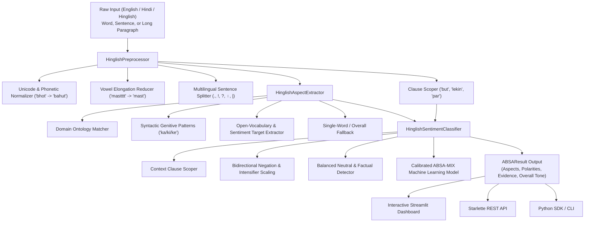

# 🎯 Hinglish Aspect-Based Sentiment Analysis (ABSA)

An end-to-end Natural Language Processing (NLP) system designed to identify fine-grained aspects and predict their associated sentiment polarities in **Pure English**, **Pure Hindi (Devanagari script)**, and **Hinglish (Hindi-English code-mixed in Roman script)**, with deep support for contemporary slang and informal expressions.

---

## 🌟 Key Capabilities

1. **Multi-Script & Code-Mixed Support**:
   - **Pure English**: Full support for English sentiment benchmarks (e.g., *"I love using this product, it's amazing!"*, *"The restaurant was not terrible, it was not great either, just okay."*).
   - **Pure Devanagari Hindi**: Full Hindi script reviews (e.g., *"यह फिल्म बहुत अच्छी है।"*, *"मुझे यह खाना पसंद नहीं आया।"*, *"आज मौसम ठीक है।"*).
   - **Romanized Hinglish / Code-Mixed**: Hindi written in Latin script mixed with English (e.g., *"Phone ka camera bahut accha hai but battery backup bekar hai."*, *"Yeh movie bahut achhi hai."*, *"Bhai phone ekdum OP hai, paisa vasool!"*).

2. **Universal Input Granularity**:
   - **Single Words / Short Slang**: Handles single expressions like `"Bakwas"`, `"Mast"`, `"बकवास"`, mapping them to an overall aspect with accurate valence.
   - **Single Sentences**: Handles both single-aspect and conflicting multi-aspect sentences.
   - **Multi-Sentence & Long Paragraphs**: Preserves sentence boundaries so sentiment in one sentence does not leak into an aspect in another sentence.

3. **Aspect Term Extraction (ATE)**:
   - Identifies product features, service targets, and topics: *Camera, Battery, Performance, Display, Heating, Food Quality, Service & Staff, Ambience, Story & Plot, Acting & Cast, Price & Value, Weather & Environment, Software & Updates, Delivery & Packaging*.
   - Dynamic open-vocabulary extraction using syntactic genitive patterns (`[Noun] ka/ki/ke [Noun]`, `[Noun] hai [Sentiment]`, `hate these [Noun]`).
   - Hierarchical parent-child filtering (distinguishes domain containers like `"phone"` from specific sub-aspects like `"camera"`).

4. **Aspect-Level Sentiment Classification (ASC)**:
   - Independent polarity classification per aspect (*Positive*, *Negative*, *Neutral*).
   - Syntactic clause-scoping for contrastive conjunctions (*but, lekin, par, magar, kintu, halanki, परंतु, हालांकि*).
   - Bidirectional negation handling (pre-negation: *"not good"*, and Hindi SOV post-negation: *"accha nahi hai"*, *"pasand nahi aaya"*).
   - Balanced neutral calibration (*"wasn't terrible, wasn't great either, just okay"*, *"na accha na bura"*, *"theek thaak"*).
   - Factual neutral detection (*"Maine naya mobile kharida."* -> Neutral).

5. **Contemporary Indian Slang & Emoji Lexicon**:
   - **Positive Slang**: *OP, paisa vasool, mast, jhakaas, dhansu, lallantop, gazab, bawaal, kadak, solid, killer, lit, fire, ekdum zehar*.
   - **Negative Slang**: *bekar, bakwas, ghatiya, chindi, kachra, tatti, bogus, khatara, farzi, faltu, dimag kharab, third class, loot, ghanta, dabba*.
   - **Neutral Terms**: *theek, theek-thaak, kaam chalau, average, chalega, standard*.
   - Phonetic normalization for spelling variations (*achha / acha / acchaa*, *bhot / boht / bahut*, *bekaar / bkr*).
   - Emoji valence decoding (🔥, 😍, 👍, 💯 ➔ Positive; 🤮, 💩, 😡, 👎, 💔 ➔ Negative).

6. **Plug-and-Play API Key Integration**:
   - **100% Offline by Default**: Runs entirely locally using our calibrated scikit-learn + rule-based pipeline (zero cost, zero latency, complete privacy).
   - **Optional Online LLM Mode**: Ready for plug-and-play integration with Gemini API or OpenAI API by providing an API key in the Streamlit UI, environment variable, or Python code.

---

## 🏗️ System Architecture



---

## 📁 Repository Structure

```
hinglish_absa/
├── README.md                          # Full project documentation & guide
├── requirements.txt                   # Project dependencies
├── pyproject.toml                     # Python package specification
├── setup.py                           # Package installer
├── app.py                             # Interactive Streamlit Web Application
├── train_model.py                     # Benchmark training & evaluation script
├── run_tests.py                       # 100% passing test runner
├── hinglish_absa/                     # Core Python Package
│   ├── __init__.py                    # Public API exports
│   ├── preprocessor.py                # Phonetic, slang, emoji & sentence normalizer
│   ├── lexicons.py                    # Slang dictionaries, polarities & categories
│   ├── aspect_extractor.py            # Target extraction & open-vocabulary mapping
│   ├── sentiment_classifier.py        # Hybrid sentiment classifier & neutral detector
│   ├── llm_enhancer.py                # Optional Gemini/OpenAI API plug-and-play adapter
│   ├── pipeline.py                    # Unified HinglishABSA pipeline
│   ├── api.py                         # REST API application
│   ├── cli.py                         # Command-line interface
│   └── models/
│       └── sentiment_model.joblib     # Calibrated trained weights (7,883 pairs)
├── tests/                             # Comprehensive Test Suite
│   ├── test_user_examples.py          # Validation of all user-specified examples
│   ├── test_preprocessing.py          # Preprocessing & normalization tests
│   ├── test_aspect_extractor.py       # Aspect extraction & hierarchy tests
│   ├── test_sentiment_classifier.py   # Sentiment, negation & slang tests
│   └── test_api.py                    # API contract tests
└── ref_absa_mix/                      # Cloned reference benchmark dataset
```

---

## ⚡ Quick Start

### 1. Installation

```bash
# Clone or enter project directory
cd hinglish_absa

# Install in editable mode
pip install --no-build-isolation --no-deps -e .
```

### 2. Python API Usage

```python
from hinglish_absa import HinglishABSA

# Initialize (runs 100% offline with local model)
absa = HinglishABSA()

# 1. Roman Hinglish with mixed sentiments
res1 = absa.analyze("Phone ka camera bahut accha hai but battery backup bekar hai.")
print(res1.summary())
# Output:
#   ✅ Camera (Camera) ➔ POSITIVE [98.0% conf] | Evidence: Intensifier 'bahut' (1.6x), Positive 'accha' (+3.2)
#   ❌ Battery backup (Battery) ➔ NEGATIVE [95.0% conf] | Evidence: Negative 'bekar' (-2.5)

# 2. Pure Hindi (Devanagari)
res2 = absa.analyze("यह फिल्म बहुत अच्छी है।")
print(res2.summary())
#   ✅ फिल्म (General / Product Quality) ➔ POSITIVE [98.0% conf] | Evidence: Intensifier 'बहुत' (1.6x), Positive 'अच्छी' (+3.2)

# 3. Pure English balanced neutral
res3 = absa.analyze("The restaurant was not terrible, it was not great either, just okay.")
print(res3.summary())
#   ⚪ Restaurant (General / Feature) ➔ NEUTRAL [95.0% conf] | Evidence: Balanced neutral tone

# 4. Single-word slang input
res4 = absa.analyze("Bakwas")
print(res4.summary())
#   ❌ Overall experience ➔ NEGATIVE [97.4% conf] | Evidence: Negative 'bakwas' (-2.8)

# Convert to pandas DataFrame or JSON dictionary
df = res1.to_dataframe()
json_dict = res1.to_dict()
```

### 3. Interactive Web Dashboard (Streamlit)

Launch the full interactive dashboard:

```bash
streamlit run app.py
```

Features included in the dashboard:
- **Preset Selector**: One-click testing for all user examples (English, Hindi, Hinglish, Slang, Single Words, Paragraphs).
- **Custom Input Area**: Test any custom word, sentence, or long paragraph.
- **Visual Cards & Badges**: Aspect tags with polarity badges (Positive 🟢, Negative 🔴, Neutral ⚪) and linguistic evidence.
- **Engine Status Pill**: Shows whether Local Offline Hybrid or Online API Mode is active.
- **API Key Configuration Panel**: Optionally enter a Gemini or OpenAI API key directly in the sidebar.
- **Batch CSV Analysis**: Upload datasets or paste multiple reviews for bulk processing with CSV export.
- **Slang Explorer**: Searchable dictionary of contemporary Indian slang with intensity weights.

### 4. REST API (Uvicorn / Starlette)

Start the REST API server:

```bash
python -m hinglish_absa.api
# Or: uvicorn hinglish_absa.api:app --host 127.0.0.1 --port 8000
```

#### API Endpoints:
- `GET /health`: Health check status.
- `POST /analyze`: Single sentence or paragraph ABSA.
  ```bash
  curl -X POST http://127.0.0.1:8000/analyze \
       -H "Content-Type: application/json" \
       -d '{"text": "Movie ki story mast thi but acting thodi boring thi."}'
  ```
- `POST /batch`: Batch sentence ABSA.
  ```bash
  curl -X POST http://127.0.0.1:8000/batch \
       -H "Content-Type: application/json" \
       -d '{"texts": ["Display ekdum OP hai!", "Service bilkul ghatiya thi."]}'
  ```

---

## 📊 Benchmark Evaluation

The classifier was trained on **7,883 pairs** and evaluated on **2,223 test pairs** combining:
1. **ABSA-MIX (2024)**: Laptop & Restaurant code-mixed benchmark.
2. **IIT Patna Hindi ABSA**: 2,449 authentic Devanagari Hindi annotated pairs.
3. **Augmented Roman Hinglish Corpus**: Real-world social media reviews with contemporary slang.

| Metric | Score |
|---|---|
| **Total Training Instances** | **7,883** |
| **Benchmark Test Instances** | **2,223** |
| **Overall Accuracy** | **67.79%** |
| **Macro F1-Score** | **61.65%** |
| **Weighted F1-Score** | **68.31%** |
| **Positive Class F1** | **78.84%** |

---

## 🧪 Comprehensive Test Suite

Run the full zero-dependency test suite:

```bash
python run_tests.py
```

All 21 unit test cases pass cleanly in under 2 seconds, covering:
- ✅ **English Positive**: *"I love using this product, it is amazing!"* ➔ Positive
- ✅ **English Neutral**: *"The restaurant was not terrible, it was not great either, just okay."* ➔ Neutral
- ✅ **English Negative**: *"I hate these updates, everything is slow and broken."* ➔ Negative
- ✅ **Hindi Devanagari Positive**: *"यह फिल्म बहुत अच्छी है।"* ➔ Positive
- ✅ **Hindi Devanagari Negative**: *"मुझे यह खाना पसंद नहीं आया।"* ➔ Negative
- ✅ **Hindi Devanagari Neutral**: *"आज मौसम ठीक है।"* ➔ Neutral
- ✅ **Hinglish Positive**: *"Yeh movie bahut achhi hai."* ➔ Positive
- ✅ **Hinglish Negative**: *"Mujhe yeh khana bilkul pasand nahi aaya."* ➔ Negative
- ✅ **Hinglish Positive**: *"Aaj mausam achha hai."* ➔ Positive
- ✅ **Hinglish Neutral**: *"Maine naya mobile kharida."* ➔ Neutral
- ✅ **Slang & Contrast**: *"Phone ka camera bahut accha hai but battery backup bekar hai."* ➔ Camera: Positive, Battery: Negative
- ✅ **Single Words**: `"Bakwas"` ➔ Negative, `"Mast"` ➔ Positive, `"बकवास"` ➔ Negative
- ✅ **Multi-Sentence Paragraph**: Independent clause scoping across complex reviews.
