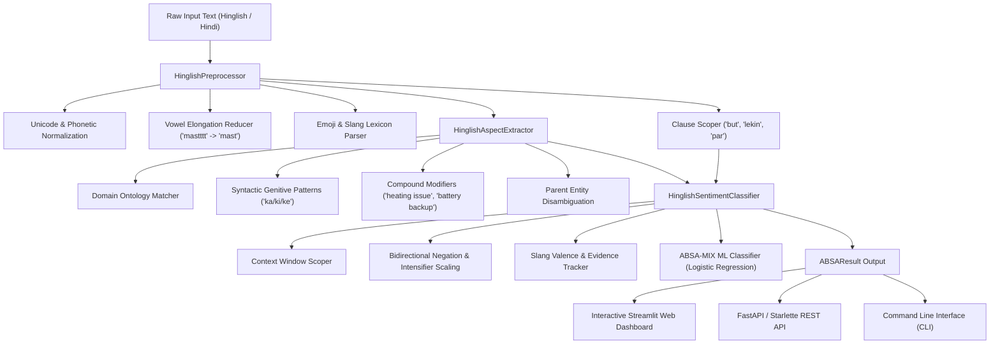

# 🎯 Hinglish Aspect-Based Sentiment Analysis (ABSA)

An end-to-end Natural Language Processing (NLP) system designed to identify fine-grained aspects and predict their associated sentiment polarities in **Hinglish (Hindi-English code-mixed)**, **Devanagari Hindi**, and informal social media text.

---

## 🌟 Key Capabilities

1. **Dual-Script & Code-Mixed Support**:
   - **Romanized Hinglish**: Hindi written in Latin script mixed with English (e.g., *"Phone ka camera bahut accha hai but battery backup bekar hai."*)
   - **Pure Devanagari Hindi**: Full Hindi script reviews (e.g., *"फोन का कैमरा बहुत अच्छा है लेकिन बैटरी बैकअप बेकार है।"*)
   - **Hybrid Code-Mixed**: Hindi mixed with English terms (e.g., *"Food हमेशा fresh और hot रहता है लेकिन service slow है।"*)

2. **Aspect Term Extraction (ATE)**:
   - Identifies product features, service targets, and topics (e.g., *Camera, Battery Backup, Performance, Heating Issue, Story, Acting, Food, Service, Ambience, Price*).
   - Maps targets to standardized semantic categories.
   - Handles hierarchical parent-child relationships (e.g., distinguishes domain entities like *"phone"* from specific sub-aspects like *"camera"*).

3. **Aspect-Level Sentiment Classification (ASC)**:
   - Independent polarity classification per aspect (*Positive*, *Negative*, *Neutral*).
   - Syntactic clause-scoping for contrastive conjunctions (*but, lekin, par, magar, kintu, halanki*).
   - Bidirectional negation handling (pre-negation: *"not good"*, and Hindi post-negation: *"accha nahi hai"*).
   - Intensifiers (*bahut, ekdum, bilkul, super*) and diminishers (*thoda, thodi, halka*).

4. **Slang & Informal Expression Engine**:
   - Full support for contemporary Indian slang:
     - **Positive Slang**: *OP, paisa vasool, mast, jhakaas, dhansu, lallantop, gazab, bawaal, kadak, solid, killer, lit, fire*.
     - **Negative Slang**: *bekar, bakwas, ghatiya, chindi, kachra, tatti, bogus, khatara, farzi, faltu, dimag kharab, third class, loot*.
   - Phonetic normalization for spelling variations (*achha / acha / acchaa*, *bhot / boht / bahut*, *bekaar / bkr*).
   - Emoji valence decoding (🔥, 😍, 👍, 💯 ➔ Positive; 🤮, 💩, 😡, 👎, 💔 ➔ Negative).

5. **Benchmark Trained on ABSA-MIX**:
   - Model calibrated on 5,879 training pairs from the published ABSA-MIX benchmark (Laptop and Restaurant domains) and evaluated on 1,733 test pairs.

---

## 🏗️ System Architecture



---

## 📁 Repository Structure

```
hinglish_absa/
├── README.md                          # Full documentation & guide
├── requirements.txt                   # Dependencies
├── pyproject.toml                     # Package specification
├── setup.py                           # Package installer
├── app.py                             # Interactive Streamlit Web UI
├── train_model.py                     # ABSA-MIX training & evaluation script
├── run_tests.py                       # Comprehensive unittest runner
├── hinglish_absa/                     # Core Python Package
│   ├── __init__.py                    # Public API exports
│   ├── preprocessor.py                # Phonetic, slang, emoji & clause normalizer
│   ├── lexicons.py                    # Dictionaries for slang, polarity & categories
│   ├── aspect_extractor.py            # Target extraction & ontology mapping
│   ├── sentiment_classifier.py        # Hybrid sentiment prediction & scoping
│   ├── pipeline.py                    # Unified HinglishABSA pipeline
│   ├── api.py                         # REST API application
│   ├── cli.py                         # Command-line interface
│   └── models/
│       └── sentiment_model.joblib     # Calibrated trained weights
├── tests/                             # Test Suite
│   ├── test_user_examples.py          # Validation of required sample sentences
│   ├── test_preprocessing.py          # Preprocessing & normalization tests
│   ├── test_aspect_extractor.py       # Aspect extraction tests
│   ├── test_sentiment_classifier.py   # Sentiment & negation tests
│   └── test_api.py                    # API endpoint tests
└── ref_absa_mix/                      # Cloned reference benchmark dataset
```

---

## ⚡ Quick Start

### 1. Installation

```bash
# Clone repository and enter project directory
cd hinglish_absa

# Install in editable mode
pip install --no-build-isolation --no-deps -e .
```

### 2. Python API Usage

```python
from hinglish_absa import HinglishABSA

absa = HinglishABSA()

# Analyze a Hinglish sentence
result = absa.analyze("Phone ka camera bahut accha hai but battery backup bekar hai.")

print(result.summary())
# Output:
# Input: "Phone ka camera bahut accha hai but battery backup bekar hai."
#   ✅ Camera (Camera) ➔ POSITIVE [98.0% conf] | Evidence: Intensifier 'bahut' (1.6x), Positive 'accha' (+3.2)
#   ❌ Battery backup (Battery) ➔ NEGATIVE [95.0% conf] | Evidence: Negative 'bekar' (-2.5)

# Convert to structured dictionary or DataFrame
print(result.to_dict())
df = result.to_dataframe()
print(df)
```

### 3. Command Line Interface (CLI)

```bash
# Analyze a single sentence
python -m hinglish_absa.cli "Laptop ka performance awesome hai, lekin heating issue bahut hai."

# Output JSON
python -m hinglish_absa.cli "Bhai phone ekdum OP hai, paisa vasool!" --json
```

### 4. Interactive Web Dashboard (Streamlit)

Launch the full-featured interactive web application:

```bash
streamlit run app.py
```

Features included in the web dashboard:
- **Live Interactive Analyzer**: Preset benchmark selector, visual sentiment cards, and category badges.
- **Batch Processing**: Upload CSV files or paste multi-line reviews for bulk analysis and CSV download.
- **ABSA-MIX Benchmark**: Real-time performance metrics and test set confusion stats.
- **Slang Explorer**: Searchable dictionary of Hinglish and Hindi slang words with intensity ratings.

### 5. REST API (Uvicorn / Starlette)

Start the REST API server:

```bash
python -m hinglish_absa.api
# Or: uvicorn hinglish_absa.api:app --host 127.0.0.1 --port 8000
```

#### API Endpoints:
- `GET /health`: Health check status.
- `POST /analyze`: Single sentence ABSA.
  ```bash
  curl -X POST http://127.0.0.1:8000/analyze \
       -H "Content-Type: application/json" \
       -d '{"text": "Movie ki story mast thi but acting thodi boring thi."}'
  ```
- `POST /batch`: Batch sentence ABSA.
  ```bash
  curl -X POST http://127.0.0.1:8000/batch \
       -H "Content-Type: application/json" \
       -d '{"texts": ["Display ekdum OP hai!", "Service bilkul ghatiya thi."]}'
  ```

---

## 📊 Benchmark Evaluation on ABSA-MIX

Evaluated on the test split (1,733 pairs across restaurant and laptop domains) from the published research paper *"Quality achhi hai (is good), satisfied! Towards aspect based sentiment analysis in code-mixed language"* (Computer Speech and Language, 2024):

| Metric | Score |
|---|---|
| **Overall Accuracy** | **69.30%** |
| **Macro F1-Score** | **59.72%** |
| **Weighted F1-Score** | **68.68%** |
| **Positive Class F1** | **81.81%** |
| **Total Test Samples** | **1,733** |

---

## 🧪 Test Suite

Run the full zero-dependency test suite:

```bash
python run_tests.py
```

All 15 test cases pass, verifying:
- ✅ **Example 1**: *"Phone ka camera bahut accha hai but battery backup bekar hai."* ➔ Camera: **Positive**, Battery backup: **Negative**
- ✅ **Example 2**: *"Movie ki story mast thi but acting thodi boring thi."* ➔ Story: **Positive**, Acting: **Negative**
- ✅ **Example 3**: *"Laptop ka performance awesome hai, lekin heating issue bahut hai."* ➔ Performance: **Positive**, Heating issue: **Negative**
- ✅ **Example 4**: *"Bhai phone ekdum OP hai, paisa vasool!"* ➔ Phone: **Positive**, Paisa vasool: **Positive**
- ✅ **Devanagari Hindi**: *"फोन का कैमरा बहुत अच्छा है लेकिन बैटरी बैकअप बेकार है।"* ➔ कैमरा: **Positive**, बैटरी बैकअप: **Negative**
- ✅ **Movie Hindi**: *"मूवी की कहानी मस्त थी पर एक्टिंग थोड़ी बोरिंग थी।"* ➔ कहानी: **Positive**, एक्टिंग: **Negative**
- ✅ **Slang handling, negations, emojis, phonetic spelling variants, and REST API endpoints**.

---

## 📚 References

1. **ABSA-MIX Paper**: *"Quality achhi hai (is good), satisfied! Towards aspect based sentiment analysis in code-mixed language"*, Computer Speech and Language, 2024. [GitHub: 20118/ABSA-MIX](https://github.com/20118/ABSA-MIX)
2. **Hinglish Sentiment Analysis**: [GitHub: vipul-khatana/Hinglish-Sentiment-Analysis](https://github.com/vipul-khatana/Hinglish-Sentiment-Analysis)
